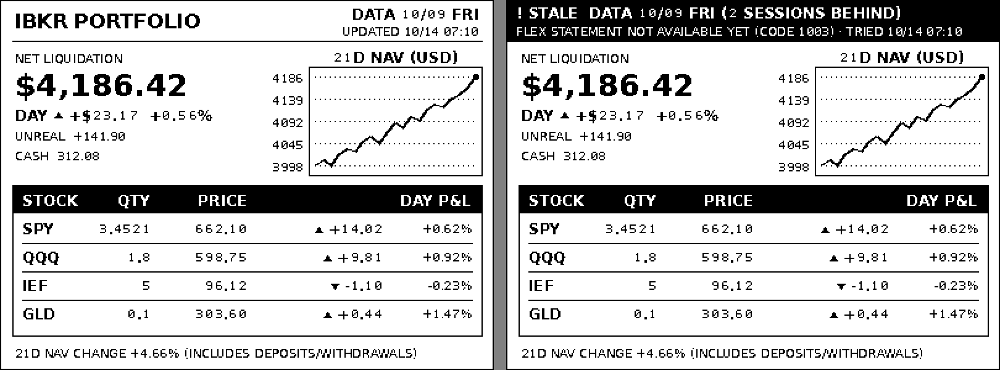

# ibkr-zectrix-dashboard

只读的 IBKR 账户看板：从 IBKR Flex Web Service 取每日报表，渲染成 400×300 黑白图，推送到 ZECTRIX NOTE4 墨水屏。

它是 [ibkr-note4-dashboard](https://github.com/JessYi228/ibkr-note4-dashboard) 的重写版，专门解决“屏幕上经常是好几天前的数据”：

| 问题（旧版） | 新版做法 |
|---|---|
| 每个工作日只在北京时间 18:17 取一次数；美股收盘（北京 04:00/05:00）后要等约 14 小时 | 每 10 分钟检查一次；按 NYSE 交易日历算出“现在应该有哪一天的报表”，收盘 1 小时后开始取，拿到新报表就推送 |
| Codex 插件依赖电脑、Codex 和 IBKR 连接都在线，任何一个断了就不更新 | 运行时不依赖任何 LLM/Codex，只需要 Flex token 和 ZECTRIX API Key |
| 取数失败直接退出，屏幕静静停在旧图 | 超过截止时间（默认收盘后 10 小时）还没拿到，屏幕顶部变成黑底 **STALE** 警告，写明数据日期、落后几个交易日、失败原因和最后尝试时间 |
| 只显示数据日期 | 同时显示 **DATA（IBKR 报表日期）** 和 **UPDATED（我们取到它的时间）** |

**重要限制：** Flex 是券商报表，数据是“最近一个已收盘交易日”，不是盘中实时。盘中实时需要 IB Gateway（每周手机确认一次登录），尚未实现。

## 屏幕

左：正常；右：数据过期（虚构样例数据）。



## 使用

完整的首次设置步骤（创建 Flex Query、生成 token、填写配置、第一次检查）见 [docs/SETUP.zh-CN.md](docs/SETUP.zh-CN.md)。

```bash
uv sync --frozen --python /usr/bin/python3
uv run ibkr-zectrix preview --output output/preview.png      # 虚构数据，不联网
uv run ibkr-zectrix init                                     # 生成 ~/.config/ibkr-zectrix-dashboard/env（600 权限）
uv run ibkr-zectrix check                                    # 真实取一次数，只渲染不推送
uv run ibkr-zectrix devices                                  # 确认 ZECTRIX key 可用（ID 脱敏）
uv run ibkr-zectrix tick --dry-run                           # 走一遍定时逻辑，不推送不存状态
uv run ibkr-zectrix tick                                     # 定时任务入口
uv run ibkr-zectrix status                                   # 查看刷新状态（不打印金额）
```

## 刷新逻辑（`tick`）

1. 用 NYSE 日历算出 *应有交易日* = 最近一个“收盘时间 + `REFRESH_READY_AFTER_MINUTES`”已过去的交易日（自动处理周末、节假日、半天市、夏令时）。
2. 已有该日报表 → 什么都不做（不联网）。
3. 没有 → 距上次尝试超过 `REFRESH_RETRY_MINUTES` 才去 IBKR 取；拿到新日期就推送。
4. 过了 `收盘 + REFRESH_STALE_AFTER_MINUTES` 仍没有 → 推送一次 STALE 屏幕；之后继续重试，恢复后自动推送正常屏幕。
5. 屏幕内容没变化时不重复推送。

`status` 里的 “First seen report …” 记录每个交易日报表第一次被取到的时间，用来按真实情况调整两个时间参数。

## 安全边界

- 只读：没有任何下单、改单、撤单代码；Flex 本身也只是报表接口。
- 凭据只放在你自己的 `~/.config/ibkr-zectrix-dashboard/env`（必须 600 权限，否则拒绝运行）。错误信息只含状态码和主机名，不含 token/URL。
- 本地只保存显示所需的数据（净值、持仓、30 日净值）在 `~/.local/state/ibkr-zectrix-dashboard/`（600 权限）；不保存原始 Flex 响应和账户号。

## 许可

部分代码改编自 ibkr-note4-dashboard（MIT），见 [NOTICE](NOTICE)。
